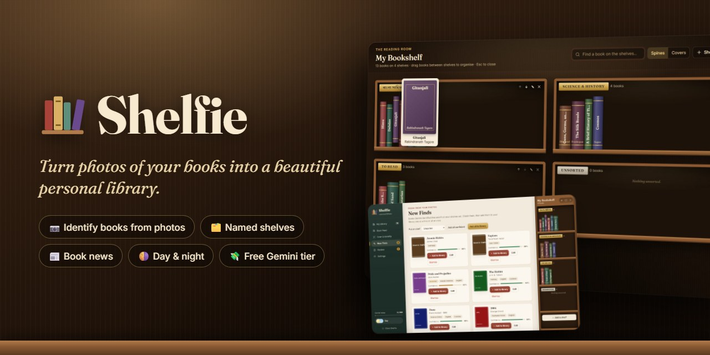
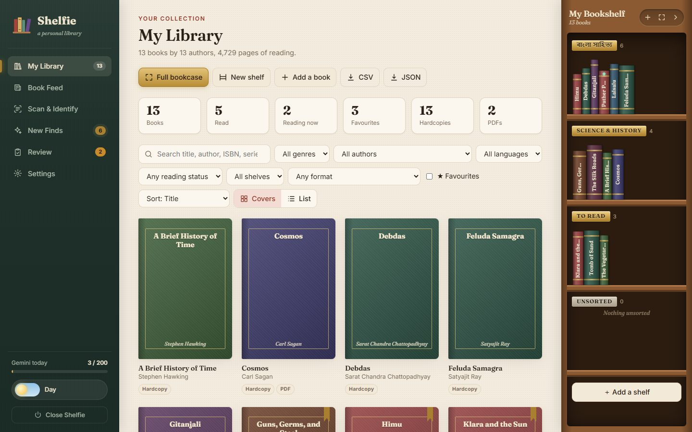
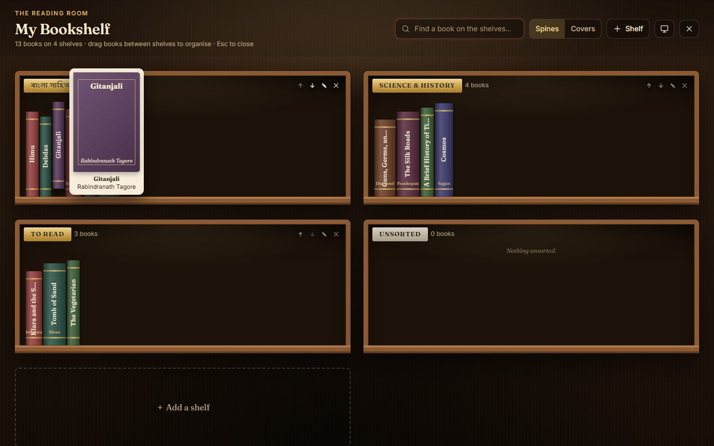
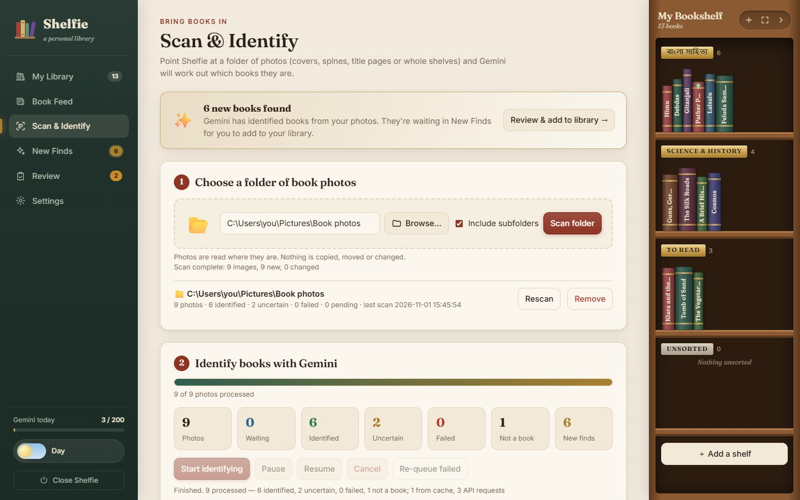
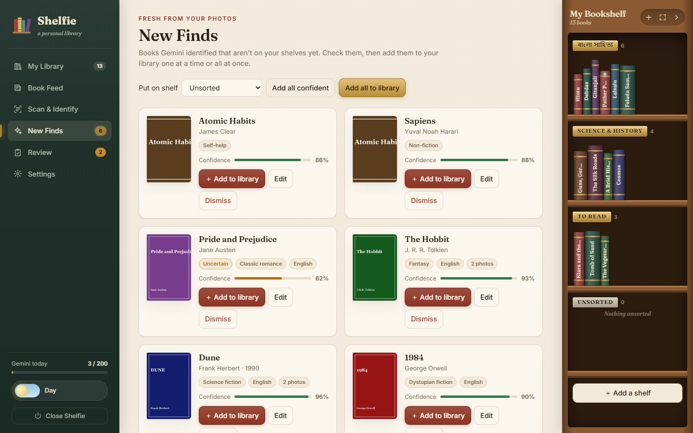
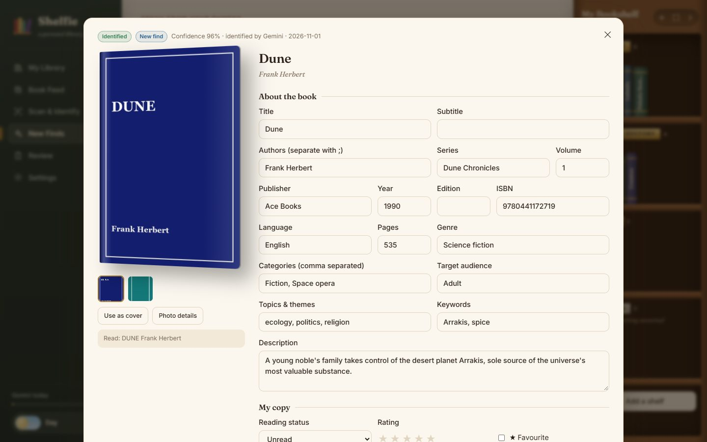
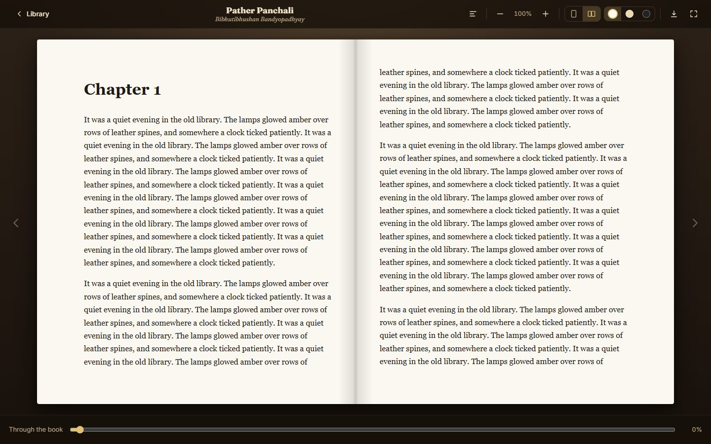
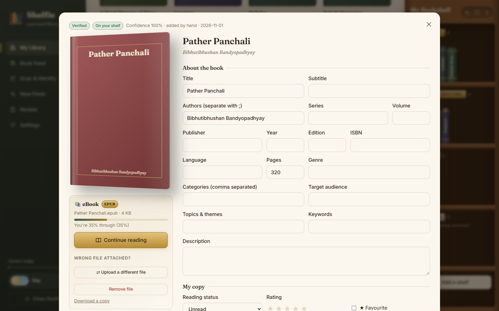
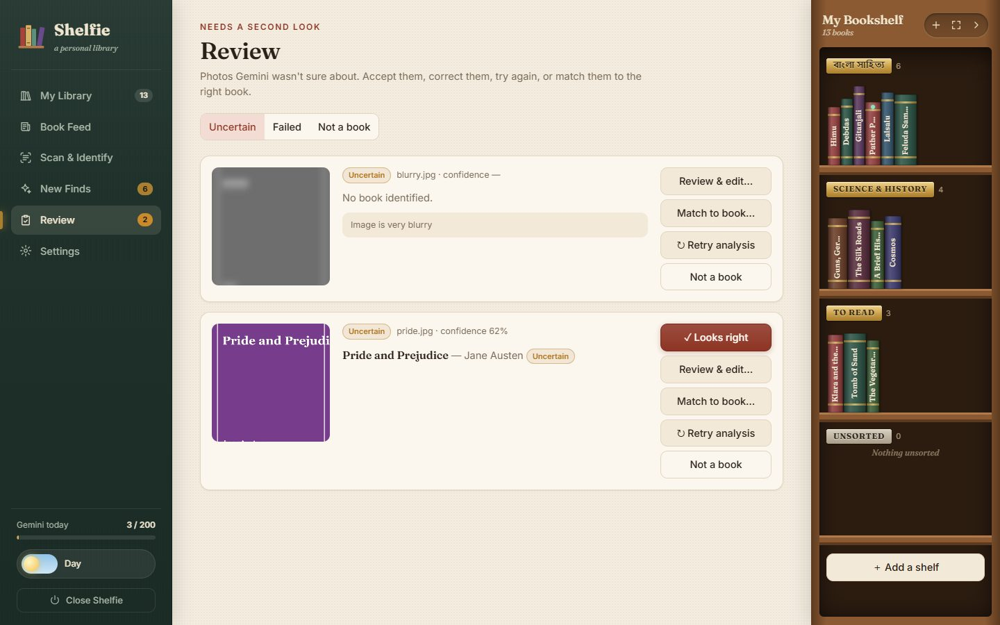
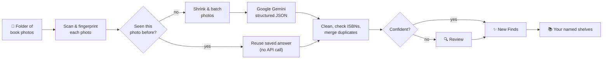

<div align="center">



# Shelfie

**Turn photos of your books into a beautiful, organised personal library.**<br>
Shelfie reads covers, spines and whole shelves with Google's free Gemini AI, fills in every book's details,
and lets you arrange them on named bookshelves, track your reading, and follow book news from around the world.


**[Quick start](#-quick-start)** · **[Features](#-features)** · **[Screenshots](#-screenshots)** ·
**[User guide](USER_GUIDE.md)** · **[How it works](#%EF%B8%8F-how-it-works)** · **[FAQ](#-faq)**

</div>

---

## ✨ Features

<table>
<tr>
<td width="50%" valign="top">

### 📷 Identify books from photos
Point Shelfie at a folder of photos (covers, spines, title pages or whole shelves) and it identifies every book:
title, authors, publisher, year, ISBN, language, genre, description, series and more.

</td>
<td width="50%" valign="top">

### 🔍 Honest, never invented
Details that aren't visible stay blank instead of being guessed. ISBNs are checksum-validated, every book has a
confidence score, and doubtful fields are highlighted for you to check.

</td>
</tr>
<tr>
<td valign="top">

### ✨ New Finds → your shelves
Review what Gemini found, then add books to your library one at a time or all at once. Watch each cover fly
onto your bookcase.

</td>
<td valign="top">

### 🗂️ Named bookshelves
Create shelves like *"বাংলা সাহিত্য"*, *"To read"* or *"Science"*. Drag and drop books between them, or open the
**full-screen bookcase** to see your whole library at once.

</td>
</tr>
<tr>
<td valign="top">

### ⭐ Track your reading
Reading status, star ratings, favourites, personal tags, notes and location, with covers taken from your
own photos. Search, filter and export to CSV (Excel) or JSON.

</td>
<td valign="top">

### 📰 Book Feed
News and reviews from The Guardian, NYT, Literary Hub, The Hindu, Indian Express, The Daily Star, Bengali
বই ও সাহিত্য news, Asian Review of Books and more. **My authors** shows stories about writers on your shelves.

</td>
</tr>
<tr>
<td valign="top">

### 💸 Built for Gemini's free tier
The same photo is never sent twice. Photos are shrunk and batched, requests are paced, and a backup model takes over
when Google is busy. Clear messages show when a daily limit is reached and exactly when it resets.

</td>
<td valign="top">

### 🌗 Lovely to use
Warm library design with day and night themes, smooth animations, and phone-friendly layouts. One-click launchers
set everything up for you. No technical knowledge needed.

</td>
</tr>
<tr>
<td valign="top">

### 📖 eBooks and a beautiful reader
Tag each book as **Hardcopy**, **eBook**, or both. Attach its **EPUB, PDF, MOBI, AZW3, FB2, DJVU, CBZ, TXT…** file.
EPUB, PDF and TXT open in a built-in reader with white, sepia and night pages, an open-book spread, chapters and
font size, and it remembers your place. Wrong file? Replace or remove it in one click.

</td>
<td valign="top">

### 🖱️ One-click start
Shelfie adds a **Shelfie** button with its own icon to your Desktop and Start menu. Click it and your library opens
in seconds. **Close Shelfie** in the app stops it when you're done.

</td>
</tr>
</table>

## 📸 Screenshots

<table>
<tr>
<td width="50%"><br><sub><b>My Library</b>: your books, with your named shelves in the bookcase on the right</sub></td>
<td width="50%"><br><sub><b>Full-screen bookcase</b>: every shelf at a glance</sub></td>
</tr>
<tr>
<td><br><sub><b>Scan &amp; Identify</b>: a whole folder, with live progress</sub></td>
<td><br><sub><b>New Finds</b>: add to your library one by one or in bulk</sub></td>
</tr>
<tr>
<td><br><sub><b>Book details</b>: everything editable, doubtful fields highlighted</sub></td>
<td><br><sub><b>Book Feed</b>: Western, Indian, Bangladeshi and Asian book news</sub></td>
</tr>
<tr>
<td><br><sub><b>Reader</b>: an EPUB open like a book, with sepia and night pages too</sub></td>
<td><br><sub><b>Hardcopy or eBook</b>: attach EPUB, PDF, MOBI…, read, and track your progress</sub></td>
</tr>
<tr>
<td><br><sub><b>Review</b>: fix anything Gemini wasn't sure about</sub></td>
<td><br><sub><b>Night mode</b>: a lamp-lit reading room</sub></td>
</tr>
</table>

## 🚀 Quick start

1. **Download Shelfie.** Click the green **Code** button above → **Download ZIP**, then unzip it
   (or `git clone https://github.com/Ifad7/shelfie.git`).
2. **Start it:**
   - **Windows:** double-click **`Shelfie-Windows.bat`**. If Python is missing, it offers to install it for you.
   - **macOS / Linux:** open Terminal, type `bash ` (with a space), drag **`Shelfie-Mac-Linux.sh`** into the window, press Enter.

   The first start takes a minute or two while it sets itself up. Then Shelfie opens in your browser.
   On Windows it offers to add a **Shelfie button** to your Desktop, so next time it's one click.
3. **Add your free Gemini key:** get one at **https://aistudio.google.com/apikey**, paste it into
   Shelfie's **Settings**, and click **Save**.

Then open **Scan & Identify**, choose a folder of book photos, and click **Start identifying**. 📚

> 📖 **New to Shelfie?** The **[User Guide](USER_GUIDE.md)** explains every feature step by step, in plain language.

## 📋 Prerequisites

| What | Needed? | Why |
|---|:---:|---|
| **Python 3.10+** | ✅ | The free program Shelfie runs on. The Windows launcher can install it for you. |
| **A web browser** | ✅ | Chrome, Edge, Firefox or Safari. Shelfie's screens open in it. |
| **Internet connection** | ✅ | Identifying books, the Book Feed, and the one-time setup |
| **A Google account** | ✅ | To get a free Gemini API key |
| **~200 MB disk space** | ✅ | Setup files and small preview images |
| **Git** | optional | Only for `git clone` / `git pull`. Otherwise use **Download ZIP**. |

**Already have Python?** On Windows run `py --version` in Command Prompt; on macOS/Linux run `python3 --version`
in Terminal. You need **3.10 or newer**.

<details>
<summary><b>🪟 Install Python on Windows</b></summary>

Choose any one:
- **Easiest:** double-click `Shelfie-Windows.bat`. When asked *"Install Python automatically now?"*, press **Y**.
- **One command:** open Command Prompt and run `winget install Python.Python.3.13`
- **By hand:** download from https://www.python.org/downloads/, run it, and ⚠️ **tick "Add python.exe to PATH"**
  on the first screen before clicking **Install Now**.

</details>

<details>
<summary><b>🍎 Install Python on macOS</b></summary>

- Download the macOS installer from https://www.python.org/downloads/ and open it, **or**
- with Homebrew: `brew install python`

</details>

<details>
<summary><b>🐧 Install Python on Linux</b></summary>

- Ubuntu / Debian / Mint: `sudo apt install python3 python3-venv python3-tk`
- Fedora: `sudo dnf install python3 python3-tkinter`
- Arch: `sudo pacman -S python tk`

(`python3-tk` is only needed for the **Browse…** folder button. You can also paste a folder path instead.)

</details>

<details>
<summary><b>🔧 Install Git (optional)</b></summary>

- **Windows:** `winget install Git.Git`, or https://git-scm.com/download/win
- **macOS:** `xcode-select --install`, or `brew install git`
- **Linux:** `sudo apt install git` / `sudo dnf install git`

</details>

## ⚙️ How it works



- **Private by design:** Shelfie runs on your own computer. Your library lives in the local `data` folder, which
  is never committed to git. Only the photos being identified are sent to Google, shrunk to a small size.
- **Free-tier friendly:** photo fingerprinting (SHA-256) means a photo is analysed once, ever. Requests are batched
  (3 photos per request by default), paced to your per-minute limit, and capped per day.
- **Resilient:** if Google is busy (503), Shelfie backs off and switches to a backup model. When a daily limit is
  reached it pauses and tells you the reset time. Photos are never marked failed because of limits.
- **Future-proof:** the default model is the `gemini-flash-latest` alias, and if Google retires a model, Shelfie
  switches to the replacement Google recommends.

## ❓ FAQ

<details>
<summary><b>Does it cost anything?</b></summary>

No. Shelfie is free and open source, and it's designed around Gemini's **free tier**. You'll need a free key from
Google AI Studio. Google limits free use per minute and per day; Shelfie stays under those limits and tells you when
you've reached them.
</details>

<details>
<summary><b>Is my data private?</b></summary>

Your library, settings and API key stay on your computer in the `data` folder. Photos are sent to Google Gemini only
to be identified. The Book Feed fetches public news feeds.
</details>

<details>
<summary><b>Which languages and books does it recognise?</b></summary>

Anything Gemini can read: English, Bengali (বাংলা), Hindi, and many more, including non-Latin scripts. Shelf names,
search and the Book Feed all work in Bengali too.
</details>

<details>
<summary><b>What photos work best?</b></summary>

Clear, well-lit, straight-on photos of covers work best. Spines, title pages and photos of whole shelves (one photo,
many books) also work. A second photo of the back cover helps Shelfie read the ISBN.
</details>

<details>
<summary><b>How do I back up or move my library?</b></summary>

Copy the `data` folder (it holds your library, settings and attached eBook files). To move to another computer, install
Shelfie there and put your `data` folder in its place.
</details>

<details>
<summary><b>🛠️ For developers</b></summary>

**Run manually**

```bash
python -m venv .venv
.venv/Scripts/pip install -r requirements.txt   # macOS/Linux: .venv/bin/pip
.venv/Scripts/python app.py                      # opens http://shelfie.localhost
```

The launchers additionally detect or install Python, repair a broken `.venv`, reinstall packages only when
`requirements.txt` changes, and recognise an already-running instance (`app.py` exits with code 3).

**Address:** Shelfie serves on port 80 when it's free, so the address is simply **http://shelfie.localhost** (Edge and Chrome
send `*.localhost` to your own computer; `http://localhost` works too). If port 80 is taken it uses 5173 or the next
free port. On macOS/Linux the address is `http://localhost` (port 80 usually needs admin rights there, so 5173 is used).

**Environment variables:** `GEMINI_API_KEY`, `PORT` (fixes the port), `SHELFIE_HOSTNAME` (the name in the address), `HOST`,
`LIBRARY_DATA_DIR` (default `./data`), `NO_BROWSER=1`.

**Stack:** Python 3.10+, Flask, Pillow, SQLite (built in), vanilla JS/CSS with no build step. Gemini is called over its
REST API with an enforced response schema. The reader uses [PDF.js](https://mozilla.github.io/pdf.js/) for PDFs (with
the browser's own viewer as an offline fallback) and [epub.js](https://github.com/futurepress/epub.js) for EPUBs,
loaded from CDNs on first use; files are served with HTTP range requests so large PDFs open quickly. Uploaded eBooks
are identified by their content (`library/ebooks.py`), not just their file extension. Optional `pillow-heif` adds HEIC photo support.

**Project layout**

```
app.py                   Flask server + REST API
library/db.py            SQLite schema and migrations, settings, usage tracking, shelf ordering
library/gemini.py        Gemini REST client, prompt, response schema, error classification
library/processor.py     Background worker: cache, batching, pacing, fallback model, pause/resume/cancel
library/catalog.py       Cleaning AI output, ISBN validation, de-duplication, linking, merging
library/scanner.py       Folder scanning and hashing (incremental re-scans)
library/imaging.py       Downscaling for upload, thumbnails, optional HEIC support
library/feeds.py         Book Feed: RSS/Atom fetching and parsing, built-in sources
library/ebooks.py        Supported eBook formats and content-based format detection
tools/make-shortcut.ps1  Creates the Desktop / Start-menu "Shelfie" button (Windows)
static/                  Single-page UI (index.html, app.js, styles.css)
Shelfie-Windows.bat      One-click launcher (Windows)
Shelfie-Mac-Linux.sh     Launcher (macOS/Linux)
USER_GUIDE.md            End-user manual (screenshots in docs/images)
```

</details>

## 📄 License

[MIT](LICENSE). Free to use, change and share.

<div align="center"><sub>Made with ❤️ for book lovers. Happy reading! 📚</sub></div>
