# Shelfie user guide

**Shelfie turns photos of your books into a tidy digital library.** Take pictures of book covers or spines, put
them in a folder, and Shelfie works out which books they are: title, author, publisher, year, description and
more. Then you arrange them on named bookshelves, track what you've read, and keep up with book news from
around the world.

This guide assumes no technical knowledge. If you can download a file and double-click it, you can use Shelfie.

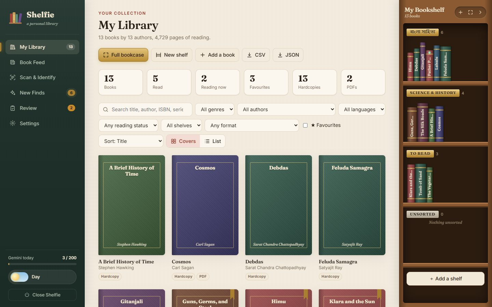

---

## Contents

1. [What you need](#1-what-you-need)
2. [Install Shelfie (first time only)](#2-install-shelfie-first-time-only)
3. [Start and stop Shelfie](#3-start-and-stop-shelfie)
4. [Get your free Google Gemini key](#4-get-your-free-google-gemini-key)
5. [A quick tour of the screen](#5-a-quick-tour-of-the-screen)
6. [Add your books from photos](#6-add-your-books-from-photos)
7. [Check the books Shelfie wasn't sure about](#7-check-the-books-shelfie-wasnt-sure-about)
8. [Your library](#8-your-library)
9. [Bookshelves: name them and arrange your books](#9-bookshelves-name-them-and-arrange-your-books)
10. [The full-screen bookcase](#10-the-full-screen-bookcase)
11. [PDFs and the reader](#11-pdfs-and-the-reader)
12. [Book Feed: news from the world of books](#12-book-feed-news-from-the-world-of-books)
13. [Settings explained](#13-settings-explained)
14. [Daily limits and what the messages mean](#14-daily-limits-and-what-the-messages-mean)
15. [Your data: where it lives, backups, moving computers](#15-your-data-where-it-lives-backups-moving-computers)
16. [Troubleshooting](#16-troubleshooting)

---

## 1. What you need

- **A computer** running Windows 10 or 11, macOS, or Linux.
- **An internet connection**, for identifying books and reading the Book Feed.
- **Python**: a free program Shelfie runs on. You install it once (step 2 explains how).
- **A free Google Gemini key**: a password-like code that lets Shelfie use Google's AI to recognise books.
  It's free and takes two minutes to get ([step 4](#4-get-your-free-google-gemini-key)).
- **Photos of your books** in a folder on your computer. Phone photos are fine.

Shelfie runs entirely **on your own computer**. Your library is not uploaded anywhere. Only the photos being
identified are sent to Google, after being shrunk to a small size.

---

## 2. Install Shelfie (first time only)

### Step 1: Get the Shelfie folder

- **If you were sent a link to the GitHub page:** click the green **Code** button, then **Download ZIP**.
  Find the downloaded file, right-click it and choose **Extract All…** (Windows) or double-click it (Mac).
  Put the extracted **Shelfie** folder somewhere easy to find, like your Documents folder.
- **If you use git:** `git clone <the link>` works too.

### Step 2: Install Python (if you don't already have it)

**Do I already have it?** On Windows, press the Windows key, type `cmd`, press Enter, then type `py --version` and
press Enter. On Mac, open **Terminal** and type `python3 --version`. If it shows **Python 3.10** or a higher number,
skip to step 3.

**Windows: the easy way**
Just go to step 3 and double-click `Shelfie-Windows.bat`. If Python is missing, Shelfie asks
*"Install Python automatically now?"*. Press **Y**. Windows may ask for permission; click **Yes**. That's it.

**Windows: by hand** (if the automatic way doesn't work)
1. Go to **https://www.python.org/downloads/** and click the big yellow **Download Python** button.
2. Open the file you downloaded.
3. ⚠️ **Important:** on the first screen, **tick the box "Add python.exe to PATH"** at the bottom.
4. Click **Install Now** and wait for it to finish.

**Mac**
1. Go to **https://www.python.org/downloads/**, download the installer and open it.
2. Click **Continue** through the steps and **Install**.

**Linux:** most Linux systems already have Python. On Ubuntu/Debian also run
`sudo apt install python3-venv python3-tk`.

See **Prerequisites** in [README.md](README.md#-prerequisites) for the full list,
including optional Git.

### Step 3: Start Shelfie for the first time

- **Windows:** open the Shelfie folder and **double-click `Shelfie-Windows.bat`**.
  - If Windows shows a blue box saying *"Windows protected your PC"*, click **More info**, then **Run anyway**.
    This appears for any file downloaded from the internet.
- **Mac / Linux:** open the **Terminal** app, type `bash ` (the word bash followed by a space), **drag the file
  `Shelfie-Mac-Linux.sh` into the Terminal window**, and press **Enter**.

The first start takes **a minute or two** while Shelfie downloads the pieces it needs. After that it starts in
a few seconds. When it's ready, **Shelfie opens in your web browser** by itself.

---

## 3. Start and stop Shelfie

- **To start:** click the **Shelfie** button on your Desktop or in the Start menu (see below), or double-click
  `Shelfie-Windows.bat` (or run `Shelfie-Mac-Linux.sh` on Mac/Linux). Your browser opens on Shelfie.
- A small black window also opens (minimised to the taskbar when you use the Shelfie button). It's the engine;
  the browser tab is just the screen. **Leave it running** while you use Shelfie.
- **To stop:** click **Close Shelfie** at the bottom of the left sidebar. Your library is saved, and the black
  window closes by itself. Closing the black window also stops Shelfie.
- **Opened it twice by accident?** No problem. Shelfie notices it's already open and shows it in your browser.
- **Closed the browser tab by accident?** Go to **http://127.0.0.1:5173** in your browser, or double-click the
  launcher again.

### The quick start button (Windows)

The first time you start Shelfie, it asks *"Add the Shelfie button?"*. Press **Y**, and a **Shelfie** button with
its own icon appears **on your Desktop and in the Start menu**. From then on, starting Shelfie is one click.

Said no, or want it back? Open **Settings** → **Quick start button** → **Add Shelfie to my Desktop**.

---

## 4. Get your free Google Gemini key

Shelfie uses Google's Gemini AI to recognise books. You need your own free "key" (a long code, like a password).

1. Go to **https://aistudio.google.com/apikey** and sign in with any Google account (e.g. Gmail).
2. Accept the terms if asked.
3. Click **Create API key**. If it asks about a project, let it create one for you.
4. Click **Copy** next to the new key.
5. In Shelfie, click **Settings** in the left sidebar.
6. Paste the key into the **API key** box.
7. Click **Test key & load models**. You should see **"✓ Key works"**.
8. Click **Save settings** at the bottom.

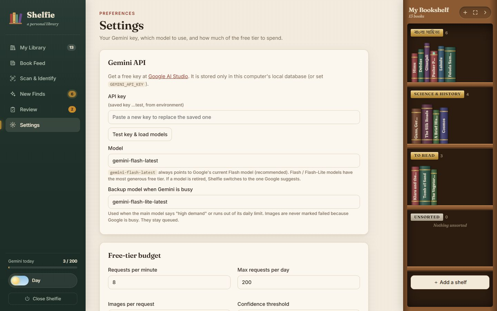

**Keep your key private**, like a password. Shelfie stores it only on your computer. It's free; Google simply
limits how much you can use it each day (see [section 14](#14-daily-limits-and-what-the-messages-mean)).

---

## 5. A quick tour of the screen

| Area | What it's for |
|---|---|
| **Left sidebar** | Moves between pages: **My Library**, **Book Feed**, **Scan & Identify**, **New Finds**, **Review**, **Settings**. Little numbers show how many items are waiting. |
| **Gemini today** (bottom left) | How many of your daily Gemini requests you've used. |
| **Day / Night switch** (bottom left) | Switches between a light parchment look and a dark, lamp-lit look. Shelfie remembers your choice. |
| **Close Shelfie** (bottom left) | Stops Shelfie when you're finished. Your library is saved. |
| **My Bookshelf** (right side) | A wooden bookcase showing every book in your library as a spine, grouped by shelf. Click a spine to open the book. The three buttons at its top: **＋** add a shelf, **⤢** open the full-screen bookcase, **›** fold the bookcase away. |

On a phone or narrow window, the sidebar becomes a row of buttons along the bottom, and the right-hand bookcase
hides itself to save space.

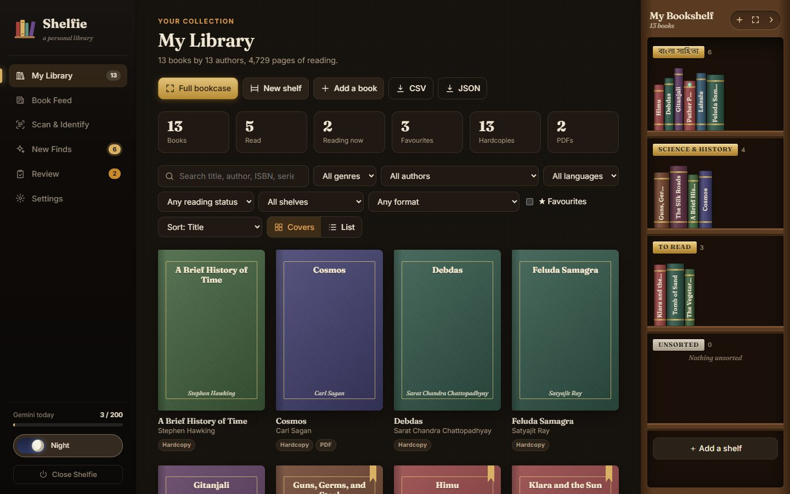

---

## 6. Add your books from photos

### Taking good photos

- **Covers** work best. **Spines** work too, and so do **title pages** and **whole shelves** (one photo can
  contain many books).
- Use good light, avoid glare on shiny covers, and keep the text straight and in focus.
- One photo per book is enough. If a book is hard to read, add a second photo, for example of the back
  cover with the ISBN barcode.
- Supported: JPG, PNG, WEBP, BMP, GIF and TIFF. (iPhone HEIC photos need an extra step; see
  [Troubleshooting](#16-troubleshooting).)

### Step A: Scan a folder

1. Click **Scan & Identify** in the sidebar.
2. Click **Browse…** and choose the folder with your photos. You can also paste the folder's path into the box.
3. Leave **Include subfolders** ticked if your photos are spread across folders inside it.
4. Click **Scan folder**. Your photos appear under **Discovered photos**.

Shelfie only *reads* your photos. It never moves, renames or changes them.

### Step B: Identify the books

1. Click **Start identifying**.
2. Watch the progress bar and counters: **Identified**, **Uncertain**, **Failed**, **Not a book** and **New finds**.
3. You can **Pause**, **Resume** or **Cancel** at any time. Nothing is lost; unfinished photos simply wait.

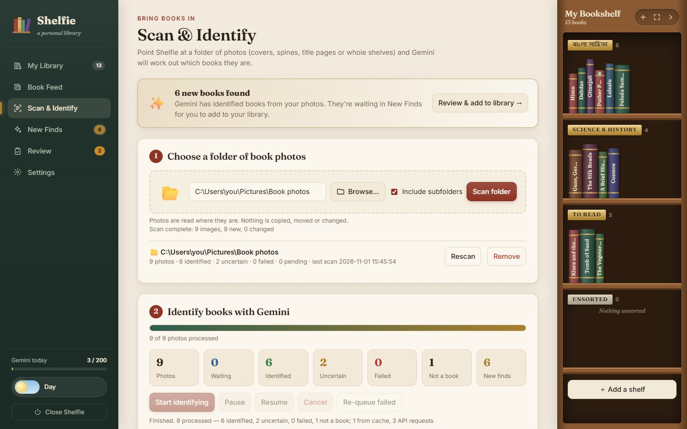

Good to know:
- **The same photo is never sent twice.** If you scan again, or have copies of a photo, Shelfie remembers the
  answer and saves your daily quota.
- **Shelfie never makes things up.** If something (like the ISBN or year) isn't visible in the photo, it's left
  blank rather than guessed. Fields the AI wasn't sure about are highlighted in orange for you to check.
- **Two photos of the same book** (for example front and spine) become **one** book with two photos.

### Step C: Add the books to your library

Identified books first go to **New Finds**, so you decide what goes on your shelves.

1. Click **New Finds** in the sidebar.
2. Optionally choose **Put on shelf** at the top to send the books straight onto a particular shelf.
3. Then either:
   - click **＋ Add to library** on a single book (watch it fly onto your bookshelf),
   - tick several books and click **Add selected to library**,
   - click **Add all to library**, or
   - click **Add all confident** to add everything except the ones Shelfie was unsure about.
4. **Edit** opens a book's details if you want to fix something first. **Dismiss** removes a wrong or unwanted find.

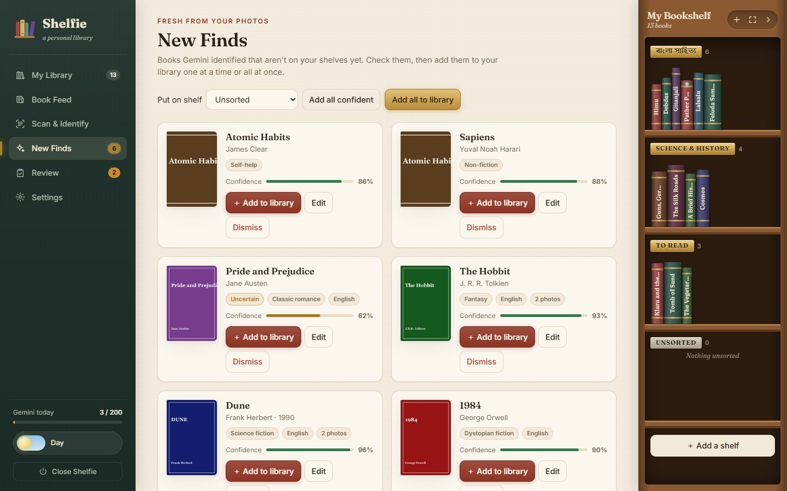

---

## 7. Check the books Shelfie wasn't sure about

The **Review** page lists photos that need a human eye. Use the buttons at the top to switch between:

- **Uncertain:** Shelfie found a book but isn't confident, or a blurry photo couldn't be read.
- **Failed:** something went wrong (for example a damaged image file).
- **Not a book:** photos Shelfie decided don't show a book.

For each photo you can:

| Button | What it does |
|---|---|
| **✓ Looks right** | Accept Shelfie's answer. |
| **Review & edit…** | Open the photo and the book details side by side to correct anything. |
| **Match to book…** | Say "this photo is of a book I already have". Pick it from a list. |
| **↻ Retry analysis** | Ask Gemini to look again (uses one request). |
| **Not a book** | Hide the photo from your library. |

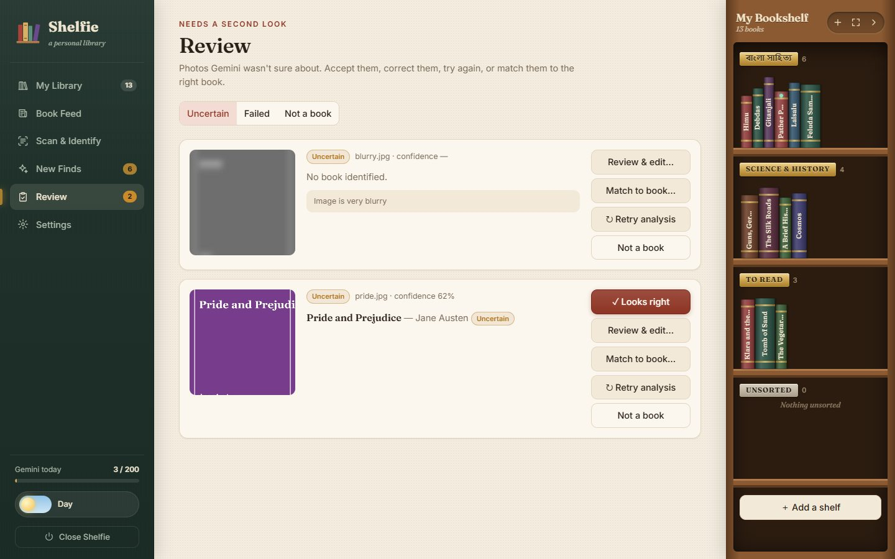

---

## 8. Your library

Click **My Library** in the sidebar.

### Ways to view your books
Use the two buttons next to the filters:
- **Covers:** a grid of book covers. Under each book, small tags show what you own: **Hardcopy** and/or **PDF**.
  Books with an uploaded PDF show a gold **Read** button when you point at them, and a thin bar showing how far
  you've read.
- **List:** a table with each book's shelf and formats, handy for large libraries.

Your **shelves** live in the wooden bookcase on the right, and in the **full-screen bookcase**
([section 10](#10-the-full-screen-bookcase)).

### Finding books
- **Search** by title, author, ISBN, series, publisher or your own tags.
- **Filter** by genre, author, language, reading status, **shelf**, **format** (Hardcopy, PDF, or "PDF uploaded"),
  or **★ Favourites**.
- **Sort** by title, author, year, recently added, rating, or your own **shelf order**.

### A book's details
Click any book to open it. You can:
- correct any detail (title, author, publisher, year, ISBN, language, genre, description, and so on),
- set **Reading status** (Unread, Reading, Read, Abandoned, Wishlist), give a **star rating** and mark it as
  a **Favourite**,
- choose which **Shelf** it sits on, note a **Room / location**, add **personal tags** and **notes**,
- tick what you own under **I own this book as**: **📕 Hardcopy**, **📄 PDF / eBook**, or both,
- **upload the book's PDF** and read it right there ([section 11](#11-pdfs-and-the-reader)),
- see all its photos, and pick which one is the cover (**Use as cover**),
- click **Check Open Library** to look the book up in a free online catalogue and fill in empty fields
  (it never overwrites what's already there),
- click **Save**, or **Save & mark verified** to say "I've checked this, it's correct".

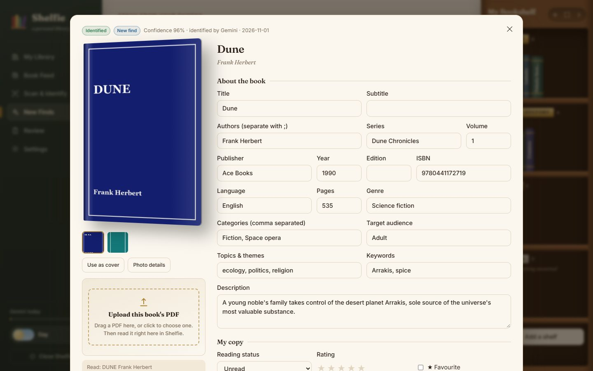

### Other handy things
- **Add a book** (top of My Library): type in a book by hand, for example one without a photo. You can attach
  its PDF at the same time.
- **Merge into one book:** if the same book appears twice, tick both and click this in the bar that appears.
  Shelfie also offers to merge when you save a book that looks like a duplicate.
- **Move back to New Finds:** takes books off your shelves without deleting them.
- **Delete:** removes a book from Shelfie. Your photos on disk are never touched.
- **CSV / JSON** (top of My Library): download your library as a spreadsheet (CSV opens in Excel or Google
  Sheets) or as a data file. Your current search and filters apply.

---

## 9. Bookshelves: name them and arrange your books

Organise your library into named shelves like *"Bangla classics"*, *"To read"* or *"Science"*.
Books that aren't on any shelf sit on **Unsorted**.

### Create, rename, reorder and remove shelves
- **Create:** click **New shelf** at the top of My Library, the **＋** on the right-hand bookcase, or
  **＋ Add a shelf** at the bottom of the bookcase. Type a name and press Enter. Any language works.
- **Rename:** double-click a shelf's gold name plate, or click **✎ Rename**.
- **Reorder:** open the **full-screen bookcase** and use the **↑ ↓** buttons on a shelf's name plate.
- **Remove:** click **Remove shelf**. Its books move to Unsorted; nothing is deleted.

### Move books around
- **Drag and drop:** in the right-hand bookcase or the full-screen bookcase, drag a book along a shelf to
  change its position, or onto another shelf to move it. The order is saved straight away.
- **Several at once:** tick books, click **Move to shelf…**, and pick a shelf (or create a new one there).
- **One book:** open it and choose its **Shelf** under "My copy".
- **New arrivals:** in New Finds, choose **Put on shelf** before adding.

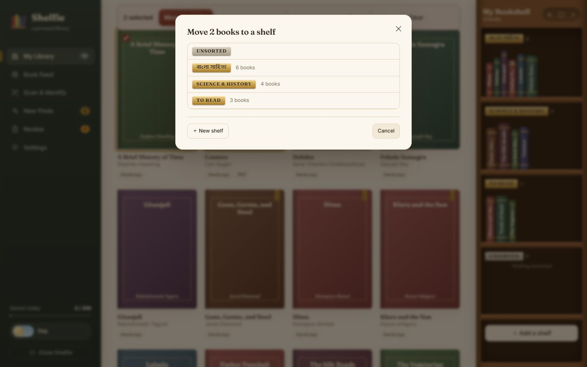

> Drag and drop needs a mouse or trackpad. On a phone or tablet, use **Move to shelf…** or the **Shelf**
> setting in a book's details instead.

---

## 10. The full-screen bookcase

When your library grows, scrolling becomes tiring. The full-screen bookcase shows **all your shelves side by
side**, like standing in front of a real bookcase.

- **Open it:** click the gold **Full bookcase** button in My Library, or **⤢** at the top of the right-hand bookcase.
- **Close it:** click **✕** at the top right, or press **Esc**.

Inside you can:
- switch between **Spines** and **Covers**,
- **hover** over a spine to pull the book out and see its cover,
- **search** with "Find a book on the shelves…": matching books glow, everything else fades,
- **drag books** between shelves, and add, rename, reorder (**↑ ↓**) or remove shelves,
- spot books you can read here: they have a small glowing **green dot** at the top of the spine,
- **click a book** to open its details,
- click the **screen** button for true full screen, which hides the browser too.

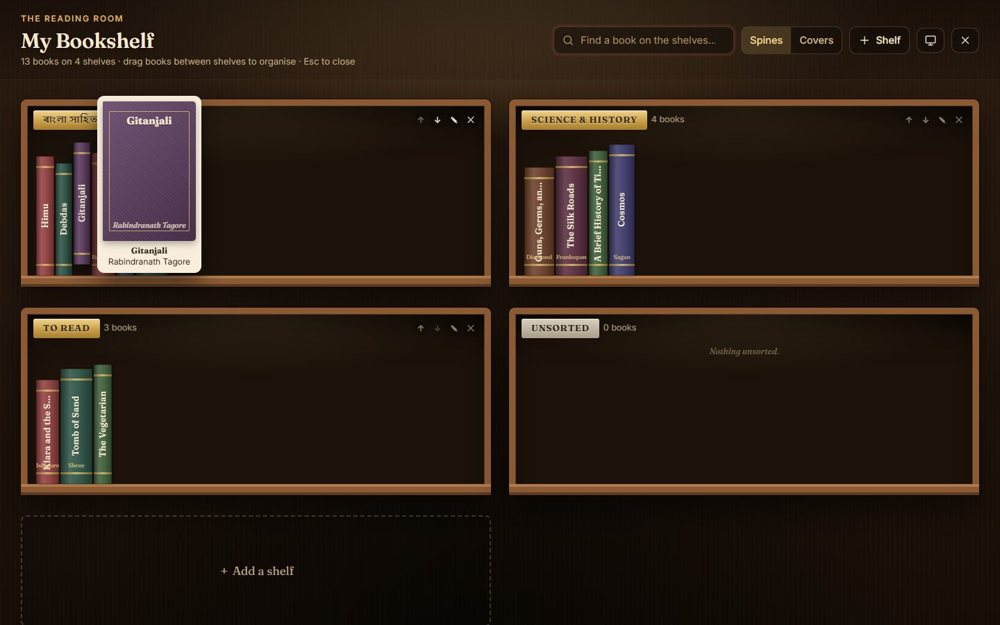

---

## 11. PDFs and the reader

Keep a PDF of a book with its entry in your library, and read it in Shelfie's built-in reader.

### Hardcopy or PDF: what do you own?
Every book can be tagged **📕 Hardcopy**, **📄 PDF / eBook**, or both. Open the book and tick the boxes under
**I own this book as**, then **Save**. Books found from your photos are tagged Hardcopy automatically. Use the
**format** filter in My Library to see, for example, only the books you own as PDFs.

### Upload a PDF
1. Open the book (click it in My Library or on a shelf).
2. In the gold **PDF** box under the cover, click **Upload this book's PDF**, or drag a PDF file onto it.
3. A progress bar shows the upload. When it's done, the book is tagged **PDF** and a **Read now** button appears.

You can **Replace**, **Download** or **Remove** the PDF from the same box. PDFs up to 600 MB are fine.

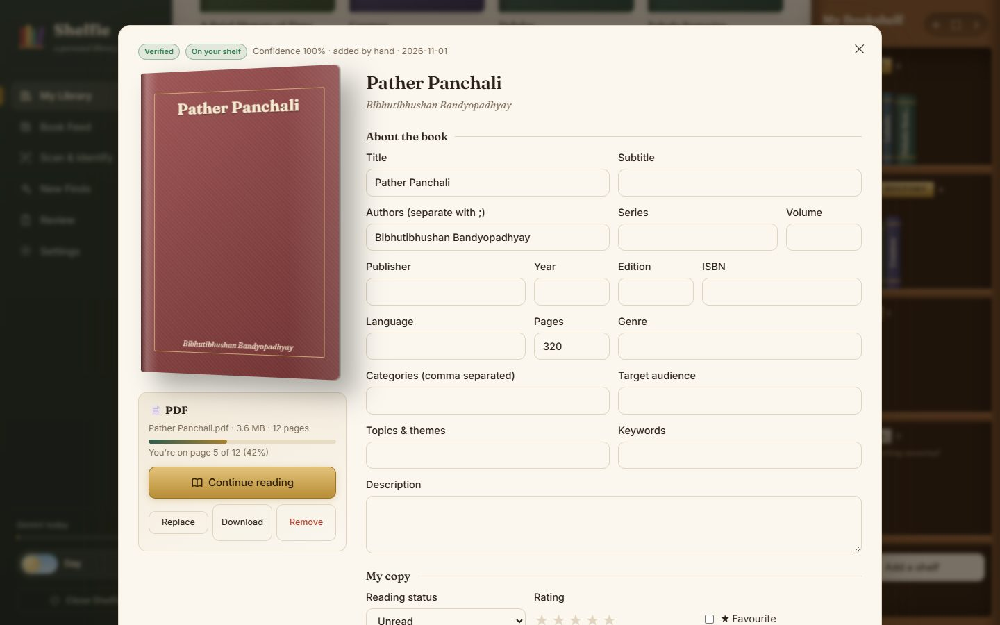

### Reading
Click **Read now** in the book's details, or the gold **Read** button on its cover in My Library.

| To… | Do this |
|---|---|
| Turn the page | Click the **‹ ›** arrows at the sides, press **← →** (or Space), scroll the mouse wheel, or swipe on a touch screen |
| Jump to a page | Type the number in the **Page** box at the bottom, or drag the slider |
| See it like an open book | Click the **two-page** button at the top |
| Change the page colour | Pick **white paper**, **sepia** or **night** (the three dots at the top) |
| Make it bigger or smaller | **＋ / −**, or the **↔** button to fit the page width |
| Go to a chapter | Click the **☰ Contents** button (if the PDF has a table of contents) |
| Read without distractions | Just read: the toolbars fade away. Move the mouse to bring them back. **⤢** goes full screen. |
| Close the reader | Click **‹ Library** at the top left, or press **Esc** |

**Shelfie remembers where you stopped.** Next time you open the book it carries on from the same page, and the
book's details show how far you've read.

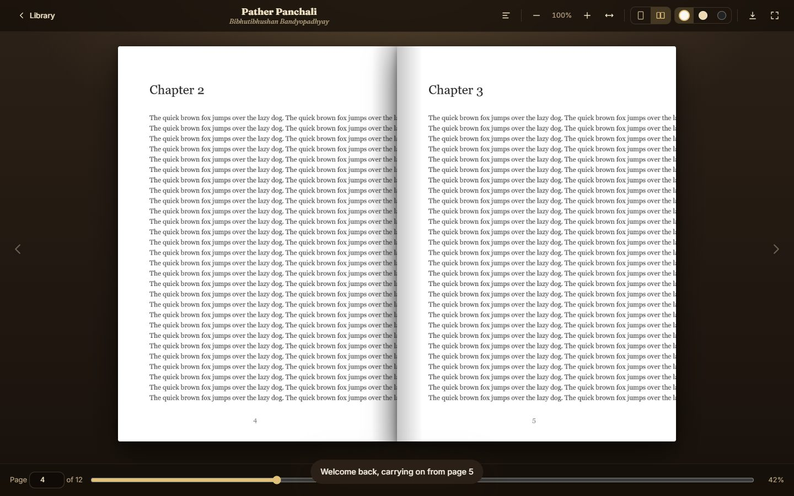

---

## 12. Book Feed: news from the world of books

**Book Feed** gathers news, reviews and interviews from book pages around the world. It doesn't use your
Gemini quota.

| Region | Sources |
|---|---|
| **Western** | The Guardian, The New York Times, Literary Hub, NPR, Book Riot, The Paris Review |
| **Indian** | The Hindu (Books and Literary Review), Indian Express, Hindustan Times |
| **Bangladeshi** | The Daily Star (Books & Literature), plus Bengali and English Google News searches for বই, সাহিত্য, লেখক, বইমেলা and Bangladeshi writers |
| **Asian & World** | Asian Review of Books, Words Without Borders, World Literature Today, East Asian literature news |

- Use the buttons at the top to show **All stories** or just one region.
- **My authors** shows only stories that mention authors on your shelves.
- **Search** the feed, and click **Load more stories** at the bottom for older ones.
- Click a story to read it on the publisher's website. It opens in a new tab.
- The feed refreshes itself every 30 minutes. Click **Refresh** to update it now.
- **Sources:** switch sources on or off, or add any news feed you like. Tip: you can follow a single author with
  a Google News link such as `https://news.google.com/rss/search?q=Humayun+Ahmed`.

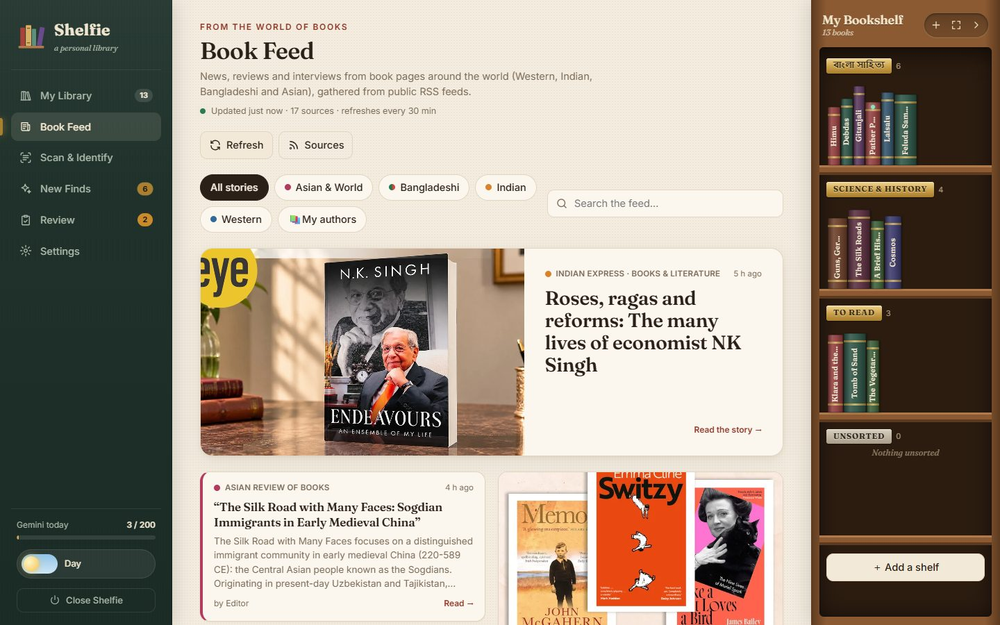

---

## 13. Settings explained

| Setting | In plain words | Suggested |
|---|---|---|
| **API key** | Your Gemini key ([step 4](#4-get-your-free-google-gemini-key)). | — |
| **Model** | Which Gemini "brain" reads your photos. | `gemini-flash-latest` |
| **Backup model** | Used automatically when the main one is too busy or out of its daily limit. | `gemini-flash-lite-latest` |
| **Requests per minute** | How fast Shelfie asks Gemini. Too fast and Google says "slow down". | 8 |
| **Max requests per day** | A safety cap so Shelfie stops before using up your free daily allowance. | 200 |
| **Images per request** | How many photos go in one request. More photos per request = fewer requests used. | 3 |
| **Confidence threshold** | Below this certainty, a book goes to Review for you to check. | 0.7 |
| **Max image size / JPEG quality** | How much photos are shrunk before sending. Smaller is faster and cheaper. | 1600 / 85 |

Google changes its free limits from time to time. To see yours, open
**https://aistudio.google.com/rate-limit** and set Shelfie's numbers a little below them.

---

## 14. Daily limits and what the messages mean

Google's free plan allows a certain number of requests **per minute** and **per day**. Daily limits reset at
**midnight California time**: around 1–2 PM in Bangladesh, 12:30–1:30 PM in India, or 8 AM in the UK, depending
on the time of year. The limit banner always shows the exact reset time for you.

| Message | What it means | What to do |
|---|---|---|
| **"Gemini's per-minute limit reached. Waiting…"** | Shelfie is going a bit fast. | Nothing. It waits and carries on by itself. |
| **"Gemini is busy (Google's side), retrying…"** | Google's servers are overloaded. | Nothing. Shelfie retries and may switch to the backup model. |
| 🌩️ **"Gemini is overloaded right now"** (banner) | Google stayed busy for several minutes. | Click **Resume** a little later. Your photos are still queued. |
| ⏸️ **"Your daily request limit is used up"** (banner) | You reached the safety cap set in Settings. | Raise **Max requests per day** in Settings and click **Resume**, or resume after the reset. |
| ⛔ **"Gemini's free daily limit has been reached"** (banner) | Google's free allowance for today is used up. | Wait for the reset time shown in the banner, then click **Resume**. |

**Photos are never marked "failed" because of limits or busy servers.** They wait in the queue until you resume.

---

## 15. Your data: where it lives, backups, moving computers

- Everything Shelfie knows (your books, shelves, settings, API key and uploaded PDFs) is in the **`data` folder**
  inside the Shelfie folder. PDFs are in `data/pdfs`. Your photos stay where they were.
- **Back up:** copy the `data` folder somewhere safe (a USB stick, cloud drive, etc.).
- **Move to a new computer:** install Shelfie there ([step 2](#2-install-shelfie-first-time-only)), then copy
  your old `data` folder into the new Shelfie folder, replacing the empty one. If your photos are in a different
  place on the new computer, go to **Scan & Identify** and scan the folder again. Already-identified photos are
  recognised and won't use any quota.
- **Get a newer version of Shelfie:** download the new version (or run `git pull`) and keep your `data` folder.
  The launcher updates everything else by itself on the next start.
- **Start completely fresh:** close Shelfie and delete the `data` folder. Your photos are not affected.

---

## 16. Troubleshooting

**"Python is not installed" / the window flashes and closes**
When the launcher asks *"Install Python automatically now?"*, press **Y**. If that doesn't work, install Python
from https://www.python.org/downloads/ and make sure you **tick "Add python.exe to PATH"**.
If you already installed it without that box, run the installer again, choose **Modify**, and tick
**"Add Python to environment variables"**.

**"Windows protected your PC"**
Click **More info**, then **Run anyway**. Windows shows this for files downloaded from the internet.

**Setup failed / "Something went wrong during setup"**
Check your internet connection, then double-click the launcher again. If it keeps failing, delete the
`.venv` folder inside the Shelfie folder (not the `data` folder!) and try again. The `.venv` folder may be
hidden; it's safe to delete because Shelfie rebuilds it.

**The browser didn't open**
Open your browser and go to **http://127.0.0.1:5173**. If that doesn't work, look at the black window: it shows
the exact address on the line *"Shelfie is running at …"*.

**"Browse…" doesn't open a folder window**
Copy the folder's path instead and paste it into the box. On Windows, open the folder in File Explorer, click
the address bar, and copy.

**"Add your Gemini API key in Settings to start"**
See [step 4](#4-get-your-free-google-gemini-key).

**"Gemini rejected the API key"**
The key was copied incompletely or was deleted. Create a new one at https://aistudio.google.com/apikey and paste it in Settings.

**"The selected model isn't available"**
Google retires older models now and then. In Settings, set **Model** to `gemini-flash-latest`, click **Save**,
then **Resume**.

**iPhone photos (HEIC) are not found**
Open `requirements.txt` in Notepad, remove the `#` in front of `pillow-heif`, save, and start Shelfie again.
Or set your iPhone to take JPG photos: *Settings → Camera → Formats → Most Compatible*.

**A book was identified wrongly**
Open it, correct the details and click **Save & mark verified**. Or, in Review, use **↻ Retry analysis** or
**Match to book…**.

**The Book Feed says some sources are "not responding"**
News websites occasionally have problems. The rest of the feed keeps working. Click **Refresh** later, or
switch that source off under **Sources**.

**The PDF reader looks plain, or says it's using the browser's viewer**
Shelfie's reader downloads its page-drawing engine from the internet the first time. Without internet, your
browser's built-in PDF viewer is used instead. Your book still opens.

**"That file is too big" / "That file isn't a PDF"**
PDFs up to 600 MB can be uploaded. Make sure the file really is a PDF (it ends in `.pdf`).

**"The old PDF is still open somewhere"**
Close the reader (and any other program showing that PDF), then try replacing it again.

**Everything looks old or broken after an update**
Press **Ctrl + F5** (Windows) or **Cmd + Shift + R** (Mac) in the browser to reload Shelfie fully.
